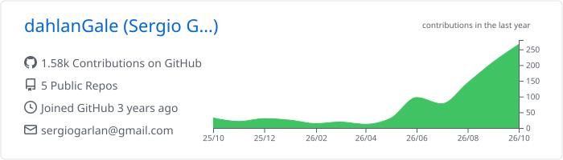
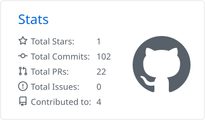
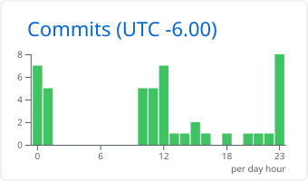

  

  

## Sobre mí

¡Hola! Sergio al habla, aquí un desarrollador de Veracruz, México (no se preocupen, mi equipo es a prueba de agua). Tengo **más de 7 años programando apps**, desde el "Hola Mundo" hasta el prompt engineering, y cuento con **4 años de experiencia desarrollando de manera profesional**: somos mi carrera técnica de Programador y mis cursos de Fernando Herrera contra el mundo. Desde hace un tiempo también me ha tocado liderar: arquitectura, organizar al equipo, consensuar con los clientes y ser el puente entre la idea que tienen en mente y el plano terrenal.

He pasado por de todo, literal: armar servidores, instalar cámaras de seguridad, apps de Android para inventarios, un ERP en VBA y Access (no lo recomiendo), CRMs, plataformas de recursos humanos, SaaS multi-tenant y varios puntos de venta. Últimamente también le meto IA a los productos, para estar a la vanguardia con las tendencias.

¡Este es mi pequeño espacio! No es mucho, pero es trabajo honesto.

## Experiencia por rol

| Rol | Experiencia |
| --- | --- |
| Desarrollador Full-Stack | 4+ años |
| Frontend Developer | 4+ años |
| Backend Developer | 4+ años |
| Tech Lead | 2+ años |
| Project Manager | 2+ años |

**Full-Stack Developer** — Llevo productos de punta a punta: modelo de datos, API, web, móvil y escritorio. En Mi Espacio Mereti trabajo en todas las capas a la vez, con un contrato de tipos compartido para que la API, la consola web y la app móvil nunca se desalineen.

**Frontend Developer** — Construyo interfaces en React y Next.js con Ant Design, Mantine o Tailwind, manejo de estado con Redux Toolkit y TanStack Query, internacionalización con i18next y clientes tipados generados desde OpenAPI. Pruebo con Vitest y Testing Library, y cuido la accesibilidad con axe.

**Backend Developer** — Diseño APIs REST con NestJS y Prisma sobre PostgreSQL y MySQL: autenticación con JWT y AWS Cognito, archivos en S3, documentación OpenAPI, validación con Zod y pruebas con Jest y Vitest. Para IA, backends con FastAPI y el OpenAI Agents SDK (RAG sobre vector stores).

**Tech Lead** — Defino la arquitectura: sistemas multiplataforma (API, web, escritorio y móvil), APIs modulares, aplicaciones multi-tenant y contratos compartidos entre equipos. Reviso código, fijo convenciones y desbloqueo al equipo cuando algo se atora.

**Project Manager** — Trabajo con Scrum y Kanban: planeación de sprints, estimación, tickets con criterios de aceptación y entregas incrementales. Coordino a desarrolladores frontend y backend, asigno y doy seguimiento al trabajo, preparo cotizaciones y reportes de avance para clientes y dirección, y llevo el control de riesgos y bloqueos.

## Stack

<table>
<tr>
<td valign="top" width="50%">

**Lenguajes**

| Tecnología | Experiencia |
| --- | --- |
|  TypeScript | 3+ años |
|  JavaScript | 3+ años |
|  Python | 3+ años |
|  HTML / CSS | 3+ años |
|  C# / .NET Framework | 2+ años |
| VBA | 2+ años |
|  Java (Android) | 1+ año |

</td>
<td valign="top" width="50%">

**Frontend**

| Tecnología | Experiencia |
| --- | --- |
|  React | 3+ años |
|  Next.js | 3+ años |
|  Redux Toolkit | 3+ años |
|  Tailwind CSS | 3+ años |
|  Ant Design | 3+ años |
|  Vite | 1+ año |
| TanStack Query | 1+ año |
|  Mantine | 1+ año |
|  Vue / Nuxt | 1+ año |
|  three.js | 1+ año |

</td>
</tr>
<tr>
<td valign="top" width="50%">

**Backend y datos**

| Tecnología | Experiencia |
| --- | --- |
|  Node.js | 3+ años |
|  Firebase | 3+ años |
| SQL Server | 2+ años |
|  NestJS | 2+ años |
|  Prisma | 1+ año |
|  PostgreSQL | 1+ año |
|  MySQL | 1+ año |
|  Supabase | 1+ año |
|  FastAPI | 1+ año |

</td>
<td valign="top" width="50%">

**Cloud, testing y herramientas**

| Tecnología | Experiencia |
| --- | --- |
|  GCP | 3+ años |
|  Git | 3+ años |
|  Docker | 2+ años |
|  Linux | 1+ año |
|  AWS | 1+ año |
|  Vitest | 1+ año |
|  Jest | 1+ año |
|  Vercel | 1+ año |

</td>
</tr>
<tr>
<td valign="top" width="50%">

**Móvil y escritorio**

| Tecnología | Experiencia |
| --- | --- |
|  React Native | 2+ años |
|  Expo | 2+ años |
|  Electron (React / React Native) | 2+ años |

</td>
<td valign="top" width="50%">

**IA e integraciones**

| Tecnología | Experiencia |
| --- | --- |
|  OpenAI | 3+ años |
|  Twilio / WhatsApp | 3+ años |
|  Google Maps | 3+ años |
|  Stripe | < 1 año |
| Facturapi (CFDI) | < 1 año |

</td>
</tr>
</table>

## Proyectos destacados

Casi todo mi trabajo vive en repositorios privados, así que aquí va un resumen de cada uno. Los que tienen enlace son públicos.

### Profesionales

| Proyecto | Qué es y qué hago | Stack |
| --- | --- | --- |
| **ScaleFlow Suite · Advance CRM** [Scaleflow](https://github.com/Scaleflow-Tech) | Suite empresarial white-label: CRM, ventas, cobranza, compras, inventario, finanzas, RH, logística y chat con IA, con un super admin que configura el branding de cada cliente. Desarrollo módulos y conecto la información entre áreas (oportunidades, pedidos, cobranza, requisiciones). | Next.js · Redux Toolkit · Firebase · Ant Design · Stripe · Twilio · OpenAI · BigQuery |
| **Profile7** [ALPHAXPACE](https://github.com/ALPHAXPACE-LLC) | Plataforma SaaS multi-tenant: organizaciones, personas, consultas, empleos, invitaciones, permisos y sesiones activas. Desarrollo el frontend y lo conecto a la API. | React · Vite · Mantine · Redux Toolkit · AWS Amplify (Cognito) · i18next · Vitest |
| **Mi Espacio Mereti** [Mereti Systems](https://github.com/Mereti-Systems) | Plataforma de recursos humanos multiempresa: consola web, app móvil de asistencia con geolocalización y notificaciones push, API y asistente con IA (RAG). Trabajo en todas las capas, con un contrato de tipos compartido entre API, web y móvil. | NestJS · Prisma · MySQL · AWS · React + Ant Design · React Native + Expo · FastAPI · OpenAI Agents SDK |
| [**Inventory Tools Management**](https://github.com/dahlanGale/InventoryToolsManagment) IOE | App Android para la gestión de inventarios: inicio de sesión, inventarios por almacén, conteo de artículos con escáner de códigos de barras y trabajo por equipos, conectada a la base de datos de la empresa. | Java · Android · SQL Server |
| **Mercader** IOE | ERP de escritorio con punto de venta y módulo de producción. Me encargué de optimizar el sistema y desarrollar funciones nuevas. | VBA · Microsoft Access |

### Personales

| Proyecto | Qué es | Stack |
| --- | --- | --- |
| **ConstellationTree** | Árbol genealógico familiar como una constelación en 3D: cada pariente es una estrella y los hilos de luz son el parentesco. Tiene vista 3D navegable, vista de árbol por generaciones, fotos y actualización en tiempo real para toda la familia. | React · three.js (React Three Fiber) · d3-force · dagre · Firebase · Vite |
| **My OC Space** | Plataforma para artistas: perfiles públicos, feed, exploración, mensajes, subida de archivos y notificaciones push. | Next.js · Supabase (PostgreSQL) · Tailwind CSS · Web Push |
| [**GymApp**](https://github.com/dahlanGale/GymApp) | POS y gestión de membresías para gimnasios: check-in con código de barras y tarjetas NFC, credenciales imprimibles, congelación de membresías y asistencia semanal. | Electron · React · TypeScript |
| [**Taskchedule**](https://github.com/dahlanGale/taskchedule) | App de escritorio para controlar entregas escolares: distingue cuándo se rompió el plan de cuándo ya cuesta calificación, y avisa antes de cada bloque de estudio. [Descargar para Windows](https://github.com/dahlanGale/taskchedule/releases/latest). | Electron · React · TypeScript |
| **La Neta Veracruz** | Portal de eventos del Puerto de Veracruz y Boca del Río: sitio público renderizado en servidor para SEO y panel de administración para cargar y moderar eventos. | Next.js · Nuxt (Vue) · Firebase · Turborepo |
| **Comanda** En desarrollo | Plataforma de punto de venta multiplataforma: API, web, escritorio y móvil sobre un mismo contrato de API. | NestJS · Prisma · PostgreSQL · React · Electron · Expo |
| **mc-panel** | Panel de administración para servidores de Minecraft Java y Bedrock: consola, jugadores, configuración y respaldos automáticos, corriendo como servicio del sistema. | Electron · Node.js · systemd |

## Estadísticas

  <a href="https://github.com/dahlanGale?tab=repositories">
    <picture>
      <source media="(prefers-color-scheme: dark)" srcset="./profile-summary-card-output/github_dark/0-profile-details.svg">
      
    </picture>
  </a>

  <a href="https://github.com/dahlanGale?tab=repositories">
    <picture>
      <source media="(prefers-color-scheme: dark)" srcset="./profile-summary-card-output/github_dark/3-stats.svg">
      
    </picture>
  </a>
  <a href="https://github.com/dahlanGale?tab=repositories">
    <picture>
      <source media="(prefers-color-scheme: dark)" srcset="./profile-summary-card-output/github_dark/4-productive-time.svg">
      
    </picture>
  </a>

<!--
## Contacto

-->
